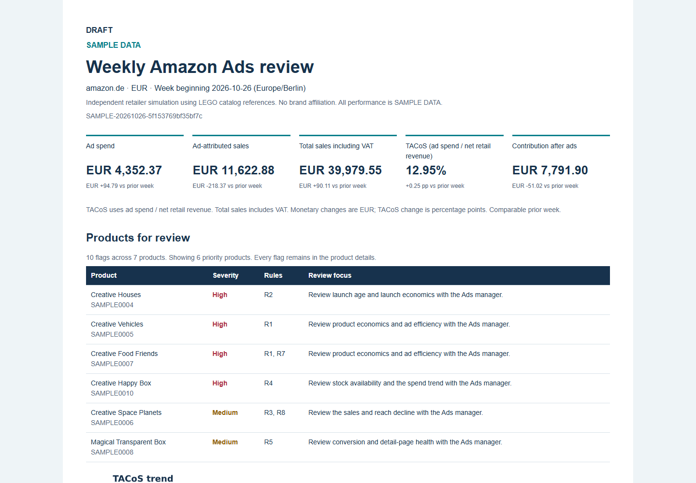
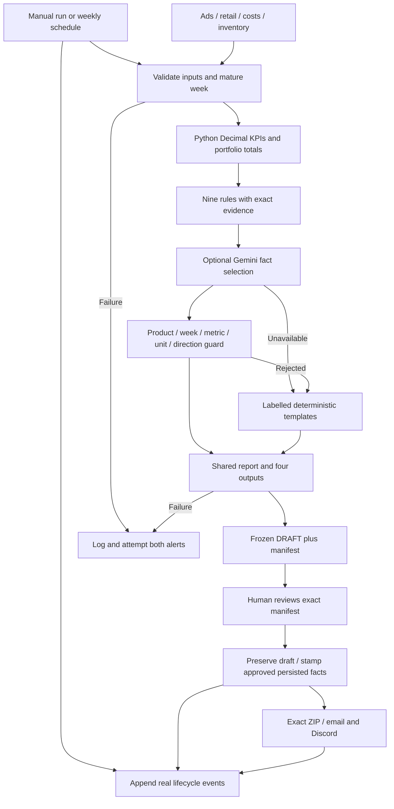

# Amazon Ads Analysis First

A working local reporting PoC for reviewing Amazon advertising economics. Python calculates KPIs, nine evidence-backed rules prioritize investigations, and checked AI commentary or labelled templates accompany Excel, HTML, PDF and PowerPoint outputs. Human approval is required before delivery.

Real LEGO catalog references identify products. All seller sales, advertising, inventory and costs are **simulated independent-retailer SAMPLE DATA**. There is no brand affiliation, live Amazon connection or claim of actual business improvement.

## Run locally

From the repository root on the configured Windows machine:

```powershell
./Start-Report.ps1
```

The launcher checks the environment, creates a fresh DRAFT, logs its real runtime and opens the local HTML. The printed `reports/<run-id>/draft` folder contains all four formats and their manifest. It uses offline templates by default. No approval or message is sent automatically. Use `-NoOpen` to stay in the terminal.

On a new machine, install free [uv](https://docs.astral.sh/uv/getting-started/installation/) first:

```shell
uv sync --locked
# Windows, one-time PDF dependencies:
uv run python scripts/setup_windows_pdf.py
uv run adsreport doctor
uv run adsreport run --no-ai --open
```

Python 3.13 and exact packages are pinned. Native dependency installation can take longer than the report itself. For Ubuntu, install `libpango-1.0-0 libpangoft2-1.0-0 libharfbuzz-subset0 fonts-dejavu-core`; see [output setup](docs/OUTPUTS.md). This is a CLI and static report viewer, with no application server or login page.

Reviewed offline examples: [Excel](docs/examples/SAMPLE_report.xlsx), [HTML](docs/examples/SAMPLE_report.html), [PDF](docs/examples/SAMPLE_report.pdf), [PowerPoint](docs/examples/SAMPLE_report.pptx). Download HTML to open it locally. These frozen P6 examples remain DRAFT and use labelled templates.



The workbook has six sheets and native charts; the sample PDF has eight A4 pages. The five-slide deck has editable native charts and all ten product notes in speaker notes. Each fresh bundle also includes three SVG/PNG chart pairs, an 80-row numerical CSV, typed JSON and per-file SHA-256 manifest.

## System and review boundary



[System map](docs/architecture.md), [input contract](docs/INPUT-CONTRACT.md), [rules](docs/RULES.md) and [operations](docs/OPERATIONS.md) describe boundaries and failure behavior. All financial calculations belong to Python. Ratios use summed amounts. Undefined denominators have explicit reasons. The golden table and property tests cover the EUR 8.44 / EUR 25.13 = 33.6% example and the contribution identities.

The seeded fixture has ten products across eight weeks, ending November 1, 2026: 1,120 daily campaign-product ad rows, 80 retail rows, 80 inventory snapshots, ten cost records and ten catalog records. Manufacturer set numbers are separate from sample ASINs/SKUs. The English classic/current column aliases and normalized support inputs are documented; actual localized exports are unverified. `uv run adsreport generate-sample --seed 42` verifies the committed inputs without overwriting different content.

The sample finds ten flags across seven products. Its six-item priority list deduplicates products while retaining all rule evidence. No bids, budgets, prices, listings, delistings or refunds are changed. Review [assumptions](docs/ASSUMPTIONS.md) with an Ads manager before using real data.

## Optional free AI

The default `adsreport run` path can use the free-verified `gemini-3.5-flash-lite` model. Create a dedicated unbilled Google AI Studio project; save `GEMINI_API_KEY` and the explicit owner attestation `GEMINI_FREE_TIER_CONFIRMED=true` in ignored `.env`. Rotate any key shared in chat before unattended use. No billing setting or paid model is enabled; the app cannot independently audit billing. Free quota and availability can change.

```shell
uv run adsreport run --open
```

Gemini selects typed facts and controlled review items; Python binds claims to product, week, metric, unit, direction and supported rounding, then renders wording. Unknown causes, targets and dates remain unknown. Invalid claims or unavailable service use visible templates. `--no-ai` makes no AI request and does not read AI credentials. One quota retry honors a delay up to 120 seconds; a longer delay uses `quota_retry_deferred` instead of retrying early. See [commentary contract](docs/COMMENTARY.md).

[P5 real-call evidence](docs/evidence/p5-gemini.json) records ten accepted notes from a genuine manual request. P6 also observed HTTP 503 and used safe templates. Its [captured-response replay](docs/evidence/p6-ai-replay.json) is explicitly not another live request. Neither proves current quota or scheduled reliability.

## Frozen approval and delivery

Review the generated files, then retain the exact digest printed by `inspect`:

```shell
uv run adsreport inspect --report reports/<run-id>/draft
uv run adsreport approve --report reports/<run-id>/draft --expect-manifest <draft-sha256> --reviewer "Patrick Jaso"
uv run adsreport inspect --report reports/<run-id>/draft-approved
uv run adsreport deliver --report reports/<run-id>/draft-approved --expect-manifest <approved-sha256>
```

Approval preserves the original draft and creates a separately hashed approved bundle from persisted facts, without another financial or AI calculation. Local identity is self-attested. Hashes bind a version to a separately retained review reference; they are not digital signatures. Email and Discord require private setup and actual receipt verification. Accepted channels are skipped on local retries; ambiguous sends require an explicit override that can duplicate a message. Provider acknowledgement is not human receipt.

The weekly workflow uses Monday 09:17 Manila (`17 1 * * 1` UTC). It uploads a frozen draft and waits for `client-delivery`, configured with owner `CardinalisUnum` and branch `main`. Application code also verifies actual owner review history. Existing workflow reruns cannot reuse the approval; start and review a fresh run. Hosted operation is currently blocked by GitHub's account billing lock. [Owner actions](docs/OWNER-ACTIONS.md) consolidates setup and acceptance tasks; [limits](docs/LIMITS.md) covers schedule delays, inactivity disabling, free-service assumptions and public-data boundaries.

## Genuine history and measurements

[Run history](runs/run-log.jsonl) contains actual local execution events; unit tests use private temporary logs. As of November 16, 2026:

| Measure | Evidence |
|---|---|
| Local manual sample build | 1 successful build; ten products, ten flags, thirteen artifacts |
| Measured pipeline duration | 6.382 seconds, excluding process startup, environment setup and human review |
| Injected failure drill | 1 explicitly labelled `test_failure`; alerts disabled pending setup |
| App-observed scheduled builds | **0 successful / 0 scheduled; rate unavailable** |
| Hosted workflow reliability | CI and one manual report could not start because of the account lock |
| Human approval / actual notifications | Not yet demonstrated |
| Manual versus assisted review savings | **Not measured**; owner stopwatch exercise pending |

The [local execution record](docs/evidence/p7-local-run.json) gives actual UTC timestamps, manifest, source commit and dirty-tree disclosure. The [manual hosted attempt](docs/evidence/p7-manual-hosted.json) records the account blocker. `uv run adsreport history` computes the scheduled numerator/denominator from observed app starts, including incomplete starts and excluding manual/injected tests. Failures before Python starts require separate Actions history. A successful build does not mean successful AI, approval, receipt or business impact.

Use [review-effort instructions](docs/REVIEW-EFFORT.md) for actual human measurements. Simulated profit differences are not recovered revenue. [Weekly analyst process](docs/PROCESS.md) and this README await owner sign-off.

## Verification and handoff

```shell
uv run ruff check .
uv run ruff format --check .
uv run mypy --strict src/
uv run pytest --cov=src/adsreport --cov-report=term-missing
```

The local suite has **222 passing tests**, with 95% overall coverage at the operations checkpoint. Numerical engine, rules, number guard and portfolio arithmetic retain dedicated full coverage. Both workflows pass actionlint locally. [P7 evidence](docs/evidence/P7-REPORT.md) identifies which checks are local, mocked or externally blocked. Hosted CI is not green and an independent release audit has not occurred.

All buildable P7 code and P8 documentation are present. Strict acceptance is **41/56 tasks, 82.3% weighted**; external operation evidence, owner sign-off/timing and P9 remain open. See the complete [phase table](docs/STATUS.md), [continuation handoff](docs/RESUME.md), [independent audit request](docs/AUDIT-HANDOFF.md), [demo script](docs/loom-script.md) and [owner decisions](docs/decisions.md). No v1.0.0 release is claimed.
