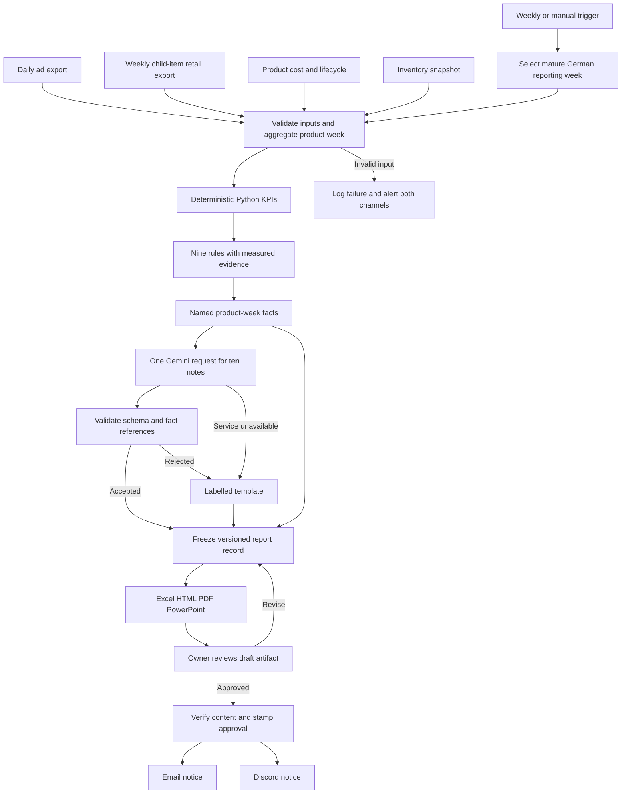

# System map

This is the proposed architecture. See STATUS.md for implementation evidence.

## Record boundaries

1. Inputs retain file provenance, reporting period, currency and tax basis.
2. Ads aggregate to one child-ASIN-week before joining retail so retail totals cannot multiply across campaigns.
3. KPI functions return values with explicit units and undefined-value reasons. All ratios use summed numerators and denominators.
4. Rules attach exact facts and config thresholds. Multiple flags can apply to one product.
5. Commentary selects facts by metric, product, week, unit and direction. Proposed design lets Python substitute formatted values for validated fact references.
6. The immutable report record is the source for all output formats. Reviewer changes create a new version.
7. Approval refers to the reviewed content. Preserve draft hashes and final stamped hashes. Verify semantic equality of the reviewed facts and commentary.
8. Delivery records each channel independently so retries reuse the approved release.

## Financial and temporal basis

Retail sample revenue includes 19% VAT. Net retail revenue removes VAT once. Preserve ad sales as reported, with their own attribution and tax basis. Use net retail revenue for this PoC's TACoS denominator and margin calculation. Organic share is a labelled residual proxy. Invalid or incomplete histories suppress dependent flags with a reason.

Separate reporting week, export cut-off, workflow execution time, review waiting time, approval timestamp and notification outcome. Backfilled sample weeks record their actual execution timestamps.

## Runtime evidence

Use stable run and attempt IDs. Append start, completion/failure, approval and delivery events referencing the same report identity. Define success at a named milestone and expose pending review separately. Trigger and test purpose are separate fields, allowing genuine scheduled runs, manual runs, backfills and injected failures to be counted correctly.

## Review checks

- Manually trace one multi-campaign product through the join and financial result.
- Demonstrate a valid value assigned to the wrong metric being rejected.
- Show the delivery job waiting for approval and both notice receipts afterward.
- Compare shared values across all four outputs, including the PDF.
- Show actual dated run history and measured review effort with sample financial results labelled.
